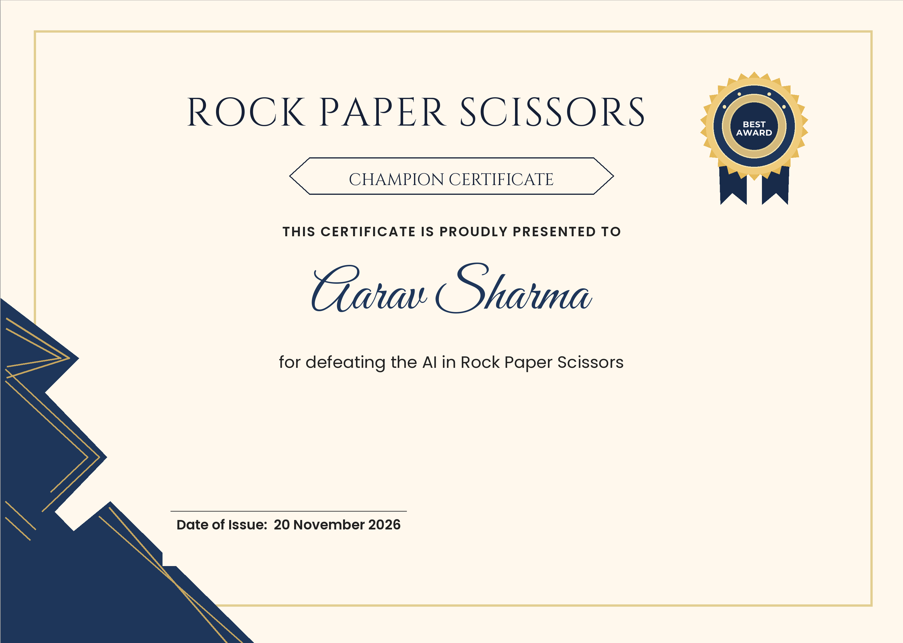

# ✊✋✌️ Rock Paper Scissors Champion Certificate API

A Flask API that generates a Champion Certificate for winning **Rock Paper
Scissors against the AI**. It draws the **name** and **current date of issue**
onto the cream/navy/gold template using Pillow — **no score required** —
ready to deploy on **Vercel** as a serverless Python function.



## Features

- ✅ Uses the uploaded cream/navy/gold template (`assets/certificate_template.png`, grey border cropped)
- ✅ Input: `name` only — **without any score**, as requested
- ✅ Auto date of issue — today's date in Asia/Kolkata, e.g. `20 November 2026`
- ✅ Champion text: **ROCK PAPER SCISSORS / CHAMPION CERTIFICATE / "for defeating the AI in Rock Paper Scissors"**
- ✅ Returns PNG (default) or lightweight JPG (`?format=jpg`)
- ✅ CORS enabled, works from any frontend
- ✅ Vercel-ready (`vercel.json` + `api/index.py`, Framework Preset: **Flask**)

## Project structure

```
rps-certificate-api/
├── api/
│   └── index.py              # Flask app (Vercel entrypoint)
├── app.py                    # Local dev entrypoint
├── assets/
│   ├── certificate_template.png   # Uploaded template (cropped)
│   └── fonts/                     # Cinzel, Great Vibes, Poppins, Montserrat
├── vercel.json               # Functions config only (NO rewrites — see deploy note)
├── requirements.txt
└── README.md
```

## API endpoints

| Method | URL | Description |
|---|---|---|
| GET | `/` | Landing page with a live generate form |
| GET | `/health` | Health check → `{"status": "ok"}` |
| GET | `/certificate?name=Aarav` | Certificate image (PNG) |
| GET | `/certificate/Aarav` | Same, via path param |
| POST | `/certificate` | JSON body `{"name":"Aarav"}` → image |
| GET/POST | `/api/certificate...` | Alias (same handlers) |

### Parameters

| Param | Required | Description |
|---|---|---|
| `name` | ✅ | Winner's name, e.g. `Aarav Sharma` |
| `date` | optional | Override date of issue, e.g. `31 October 2026` |
| `format` | optional | `png` (default), `jpg`, or `json` (base64 response) |
| `download` | optional | `true` → download as file instead of inline preview |

> There is **no score parameter** for this certificate. If a `score` is
> passed it is simply ignored.

### Examples

```bash
# 1) Browser / img tag — PNG
https://YOUR-PROJECT.vercel.app/certificate?name=Aarav%20Sharma

# 2) Lightweight JPG (recommended for web)
https://YOUR-PROJECT.vercel.app/certificate?name=Aarav%20Sharma&format=jpg

# 3) Path style
https://YOUR-PROJECT.vercel.app/certificate/Aarav%20Sharma

# 4) Download as file
https://YOUR-PROJECT.vercel.app/certificate?name=Aarav&download=true

# 5) POST JSON (returns image)
curl -X POST https://YOUR-PROJECT.vercel.app/certificate \
  -H "Content-Type: application/json" \
  -d '{"name":"Aarav Sharma"}' --output certificate.png

# 6) POST JSON → base64 (for apps that store the image)
curl -X POST https://YOUR-PROJECT.vercel.app/certificate \
  -H "Content-Type: application/json" \
  -d '{"name":"Aarav Sharma","format":"json"}'
```

### Frontend usage (JavaScript)

```html

<script>
  const name = "Aarav Sharma";
  document.getElementById("cert").src =
    `/certificate?name=${encodeURIComponent(name)}&format=jpg`;
</script>
```

Or fetch as a blob and trigger a download:

```js
const res = await fetch(`/certificate?name=${encodeURIComponent(name)}`);
const blob = await res.blob();
const a = document.createElement("a");
a.href = URL.createObjectURL(blob);
a.download = "Rock_Paper_Scissors_Champion_Certificate.png";
a.click();
```

## Run locally

```bash
pip install -r requirements.txt
python app.py
# open http://localhost:5000
```

## Deploy on Vercel

**Option A — Vercel CLI**

```bash
npm i -g vercel
vercel login
vercel        # follow prompts; framework: Flask
vercel --prod
```

**Option B — GitHub + Vercel dashboard**

1. Push this folder to a GitHub repo.
2. Go to [vercel.com/new](https://vercel.com/new) → import the repo.
3. Framework preset: **Flask** (important — not "Other").
4. Deploy — Vercel auto-detects the Flask app in `api/index.py` / `app.py`
   and routes every request to it with its original path.

> ⚠️ Do **not** add a catch-all rewrite (`/(.*)` → `/api/index.py`) to
> `vercel.json`. Vercel's Flask integration already routes all requests to
> Flask; a rewrite makes Flask receive `PATH_INFO=/api/index.py` for every
> request, which has no route — so every URL returns Flask's 404 page.
> The included `vercel.json` intentionally has **no rewrites**, only
> `functions` config to bundle `assets/**` (template + fonts) and set
> `maxDuration`.

## Customisation

- **Template:** replace `assets/certificate_template.png` with any image
  (keep the same filename). Text positions are relative to image size.
- **Fonts:** add/replace files in `assets/fonts/` and update `FONT_FILES`
  in `api/index.py`.
- **Text positions/colours:** edit `generate_certificate()` in `api/index.py`.
- **Date format:** change `current_date_str()` (currently `%d %B %Y`,
  Asia/Kolkata timezone).

## Notes

- PNG output uses fast compression (`compress_level=1`) so it stays within
  Vercel's serverless time limits — use `format=jpg` for the smallest files.
- Long names automatically shrink to fit the certificate width.
- Missing `name` returns `400 {"error": "Missing required parameter: name"}`.
